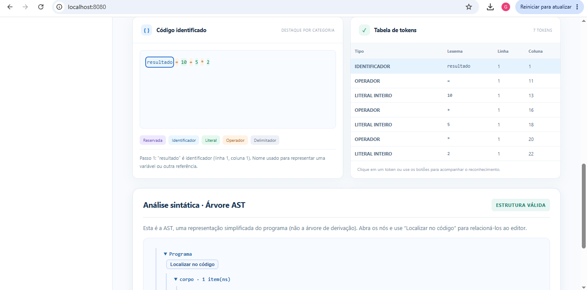
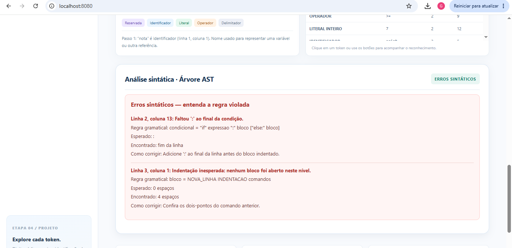

# LexLab — analisador educacional de código Python simplificado

Repositório: https://github.com/rafaelapborges/analisador-educacional

## Etapa 4 — Análise sintática e AST (2026)

A Etapa 4 amplia o LexLab com **parser descendente recursivo**, verificação sintática,
**árvore sintática abstrata (AST) hierárquica navegável**, mensagens localizadas,
indicação da regra violada e sugestões didáticas, além de testes
que preservam o scanner da Etapa 3. O subconjunto suporta atribuições, expressões,
comparações e operadores lógicos, chamadas simples, `pass`, `if`/`elif`/`else` e
`while`, com blocos de quatro espaços. O código nunca é executado.

O `POST /api/analisar` mantém os campos anteriores e acrescenta `ast`,
`erros_sintaticos` e `sintaxe`; retorna `422` diante de erro léxico/sintático.
**Com erro léxico, o parser não é executado.**

Consulte `docs/gramatica_etapa4.md`, `docs/diferencial_etapa4.md`,
`docs/casos_de_teste_etapa4.md`,
`docs/plano_de_avaliacao_etapa4.md`, `docs/registro_testes_etapa4.md` e
`docs/fluxograma_etapa4.png`.

Execute `docker compose up --build -d` e `python -m pytest tests -v`.
Esta documentação descreve a atualização proposta; registrar resultados da Etapa 4
somente após testar no ambiente local. A análise semântica e a tabela de símbolos
permanecem **futuras (Etapa 5)**.

## Histórico da Etapa 3

## O que já funciona

O LexLab é um ambiente web para experimentar o reconhecimento de tokens em um subconjunto didático inspirado em Python. A **Etapa 3** acrescenta um scanner real, integrado ao backend e à interface. O projeto preserva o editor, os exemplos, a validação de entrada, a API Flask e o ambiente Docker das etapas anteriores.

O estudante pode escrever código, escolher um exemplo e clicar em **Analisar código**. O backend percorre o texto caractere a caractere e devolve uma lista de tokens e eventuais erros. A interface apresenta:

- Lista de tokens com **tipo, lexema, linha e coluna**;
- Código com cores por categoria; ao selecionar um token, a explicação e o destaque são sincronizados;
- Navegação **Anterior / Próximo** para acompanhar cada token;
- Contagens e mensagens de erro com localização, acumulando erros quando possível;
- Cinco exemplos, incluindo um com erro léxico para experimentação.

**Limite pedagógico:** o scanner não executa código e não verifica se a sequência de tokens obedece à gramática de Python. A análise sintática (parser) será implementada na Etapa 4.

## Tecnologias

- Frontend: HTML, CSS e JavaScript puro, servido via Nginx;
- Backend: Python 3.12, Flask e Gunicorn;
- Scanner: módulo Python desenvolvido no projeto, sem bibliotecas externas de análise;
- Contêineres: Docker Compose;
- Testes: `pytest` e Playwright com Chromium.

A escolha de Python para o scanner mantém a integração simples com o backend Flask e permite inspecionar cada regra de reconhecimento em código legível. O subconjunto de entrada é **inspirado** na sintaxe Python; não equivale à implementação completa do analisador léxico do CPython.

## Subconjunto léxico implementado

| Categoria | Exemplos e regra |
| --- | --- |
| Palavras reservadas | `if`, `elif`, `else`, `while`, `and`, `or`, `not`, `True`, `False`, `None`, `pass` |
| Identificadores | `[A-Za-z_][A-Za-z0-9_]*` (ex.: `total`, `_x1`) |
| Inteiros | Dígitos `0` a `9` (ex.: `42`, `0`) |
| Reais | Dígitos, ponto, dígitos (ex.: `12.5`, `0.75`) |
| Strings | Aspas simples ou duplas; escapes básicos `\\`, `\\"`, `\\'`, `\\n`, `\\r`, `\\t`, `\\0` |
| Operadores | `+`, `-`, `*`, `/`, `%`, `=`, `==`, `!=`, `<`, `>`, `<=`, `>=`, `**`, `//` |
| Delimitadores | `(`, `)`, `[`, `]`, `{`, `}`, `:`, `,` |
| Comentários | De `#` até o final da linha; ignorados |
| Espaços | Espaços, tabulações, `\r` e `\n` são ignorados, com atualização da localização |
| Entradas inválidas | Caracteres como `@`, `$`, `;`, números malformados, strings não terminadas e escapes não suportados geram erros léxicos |

O nome `print` é reconhecido como **identificador**, pois é função embutida de Python e não palavra reservada. `INDENT` e `DEDENT`, f-strings, notação exponencial, identificadores Unicode, strings multilinha, atributos com ponto e demais construções completas de Python **não são implementados** nesta etapa. Consulte `docs/escopo_lexico.md`.

## Exemplos de entrada

```python
# Atribuições
numero = 10
total = 5
```

```python
# Operações
soma = 10 + 5
resto = soma - 2
```

```python
# Teste de erro: @ está fora do subconjunto
numero = 12
total = numero @ 2
```

## Executar com Docker Desktop

Abra um terminal na pasta raiz do projeto:

```bash
docker compose up --build -d
docker compose ps
```

Depois abra **http://localhost:8080** e use os exemplos do editor. `docker compose down` encerra os serviços.

Os arquivos Docker foram mantidos, com a inclusão do `scanner.py` no Dockerfile do backend. O Nginx encaminha requisições `/api/` para o Flask em `backend:5000`. A porta 8080 é usada apenas pelo frontend, sem expor o backend diretamente.

## Endpoints e contrato de comunicação

### `POST /api/analisar`

Cabeçalho `Content-Type: application/json`, corpo:

```json
{"codigo": "numero = 10"}
```

Exemplo resumido de resposta HTTP **200**:

```json
{
  "ok": true,
  "sucesso": true,
  "recebido": true,
  "mensagem": "Análise léxica concluída: tokens reconhecidos.",
  "linhas": 1,
  "caracteres": 11,
  "tokens": [
    {"tipo": "IDENTIFICADOR", "lexema": "numero", "linha": 1, "coluna": 1, "inicio": 0, "fim": 6},
    {"tipo": "OPERADOR", "lexema": "=", "linha": 1, "coluna": 8, "inicio": 7, "fim": 8},
    {"tipo": "LITERAL_INTEIRO", "lexema": "10", "linha": 1, "coluna": 10, "inicio": 9, "fim": 11}
  ],
  "erros": [],
  "contagem": {"IDENTIFICADOR": 1, "OPERADOR": 1, "LITERAL_INTEIRO": 1},
  "proxima_etapa": "A análise sintática será implementada na Etapa 4."
}
```

Os campos `inicio` e `fim` são índices de caracteres do texto original, em que `fim` é exclusivo; são utilizados somente para destacar tokens na interface. `linha` e `coluna` começam em 1. Para falhas léxicas, o servidor retorna HTTP **422**, `ok: false`, `sucesso: false`, preservando os tokens válidos e preenchendo `erros` com `{tipo, lexema, linha, coluna, mensagem, inicio, fim}`.

Falhas de entrada continuam com os códigos da Etapa 2: **400** para JSON inválido, ausência do campo, tipo incorreto e código vazio; **413** para código com mais de 12.000 caracteres; **415** para tipo de conteúdo não JSON.

Outras rotas: `GET /api/hello` (compatibilidade da Etapa 1) e `GET /api/health` (verificação de saúde).

## Executar os testes

Instale as dependências de teste no seu computador, se necessário:

```bash
python -m pip install pytest requests playwright
python -m playwright install chromium
```

Depois execute na pasta raiz:

```bash
python -m pytest tests -v
```

Os testes cobrem categorias e posições do scanner, entradas inválidas, strings, operações, serviço, endpoint HTTP local, navegador, novos exemplos e regressão dos recursos anteriores. A suíte de interface usa `backend/preview_server.py`, que reaproveita `service.process_source` e **não substitui** os testes do Flask e Nginx no Docker.

O registro de testes da Etapa 3 fica em `docs/registro_testes_etapa3.md`. O documento separa o que foi executado neste ambiente das verificações que precisam ser repetidas no Windows.

## Registrar a demonstração

Use `docs/roteiro_demonstracao_etapa3.md` como guia. O novo print `docs/print_interface_etapa3.png` representa uma captura do navegador de pré-visualização, com o scanner real do projeto. Tire também uma captura da versão Docker no seu computador ao concluir a validação.

## Limitações e continuidade

A Etapa 3 faz **análise léxica**, não parsing, verificação de tipos nem geração de código. O conteúdo de indentação ainda é ignorado. Por isso, `if (` pode resultar em tokenização bem-sucedida mesmo com sintaxe inválida. O reconhecimento de regras gramaticais e blocos fica para a **Etapa 4**; semântica e demais fases são previstas posteriormente.

Para publicar, copie os arquivos de atualização sobre a pasta já clonada, execute testes, confira no GitHub Desktop e use um commit descritivo. Não substitua a pasta `.git` nem apague as capturas e registros anteriores.

## Evidências de funcionamento — Etapa 4

### Análise léxica e árvore sintática (AST)



### Identificação de erros sintáticos


