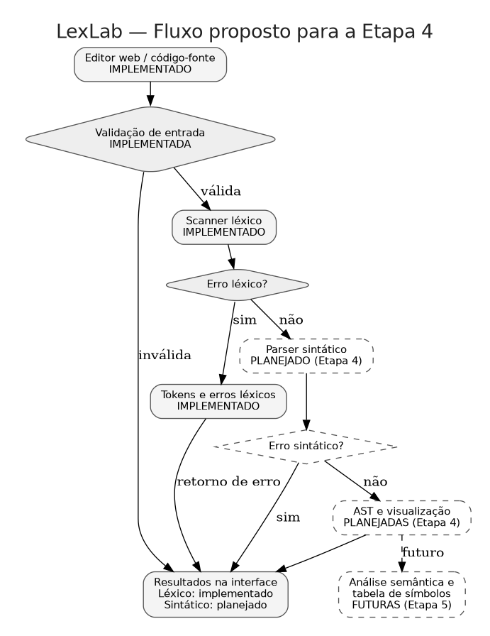

# Fluxograma da Etapa 4

As caixas com borda contínua representam elementos já existentes; as caixas tracejadas representam recursos previstos. Em caso de erro léxico, a proposta é retornar os erros sem executar o parser. A etapa semântica permanece prevista para a Etapa 5.
